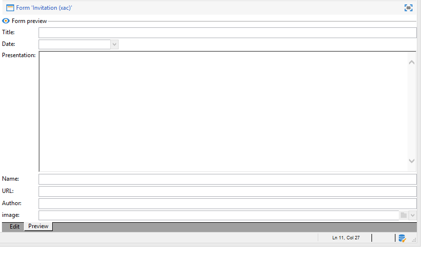
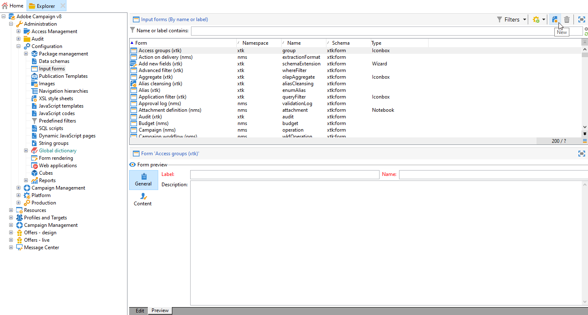

# Editar formulários{#editing-forms}

## Visão geral

Profissionais de marketing e operadores usam formulários de entrada para criar, modificar e visualizar registros. O Forms mostra uma representação visual das informações.

Como parte da transição do Campaign v7 para o v8, o conjunto de documentações do Campaign Classic foi simplificado e reorganizado. Os recursos comuns agora estão disponíveis apenas no conjunto de documentações do Campaign v8. Para saber mais sobre formulários de entrada, consulte a [documentação do Campaign v8](https://experienceleague.adobe.com/pt-br/docs/campaign/campaign-v8/developer/schemas-forms/forms){target=_blank}.

[](https://experienceleague.adobe.com/pt-br/docs/campaign/campaign-v8/developer/schemas-forms/forms){target=_blank}

É possível criar e modificar formulários de entrada:

* Você pode modificar os formulários de entrada de fábrica fornecidos por padrão. Os formulários de entrada de fábrica são baseados nos schemas de dados de fábrica.
* Você pode criar formulários de entrada personalizados, com base em esquemas de dados definidos por você.

Forms são entidades do tipo `xtk:form`. Você pode exibir a estrutura do formulário de entrada no esquema `xtk:form`. Para exibir este esquema, escolha **[!UICONTROL Administration]** > **[!UICONTROL Configuration]** > **[!UICONTROL Data schemas]** no menu. Leia mais sobre [estrutura do formulário](https://experienceleague.adobe.com/pt-br/docs/campaign/campaign-v8/developer/schemas-forms/forms){target="_blank"} (documentação do Campaign v8).

Para acessar formulários de entrada, escolha **[!UICONTROL Administration]> [!UICONTROL Configuration] >[!UICONTROL Input forms]** no menu:


Para criar formulários, edite o conteúdo XML no editor XML:


[Leia mais](https://experienceleague.adobe.com/pt-br/docs/campaign/campaign-v8/developer/schemas-forms/forms#formatting){target="_blank"} (documentação do Campaign v8).

Para visualizar um formulário, clique na guia **[!UICONTROL Preview]**:


## Tipos de formulário

É possível criar diferentes tipos de formulários de entrada. O tipo de formulário determina como os usuários navegam pelo formulário:

* Tela do console

  Este é o tipo de formulário padrão. O formulário é composto por uma única página.

  

* Gerenciamento de conteúdo

  Use este tipo de formulário para gerenciamento de conteúdo. Veja este [caso de uso](../../delivery/using/use-case-creating-content-management.md).

  

* Assistente

  Este formulário inclui várias telas flutuantes ordenadas em sequências específicas. Os usuários navegam de uma tela para outra. [Leia mais](https://experienceleague.adobe.com/en/docs/campaign/campaign-v8/developer/schemas-forms/forms#wizards){target="_blank"} (documentação do Campaign v8).

* Caixa de ícones

  Este formulário inclui várias páginas. Para navegar no formulário, os usuários selecionam ícones à esquerda do formulário.

  

* Notebook

  Este formulário inclui várias páginas. Para navegar pelo formulário, os usuários selecionam guias na parte superior do formulário.

  

* Painel vertical

  Este formulário mostra uma árvore de navegação.

* Painel horizontal

  Este formulário mostra uma lista de itens.

## Referências a imagens

Para localizar imagens, escolha **[!UICONTROL Administration]** > **[!UICONTROL Configuration]** > **[!UICONTROL Images]** no menu.

Para associar uma imagem a um elemento no formulário, por exemplo, um ícone, é possível adicionar uma referência a uma imagem. Use o atributo `img`, por exemplo, no elemento `<container>`.

Sintaxe: `img="`*`namespace`*`:`*`filename`*`.`*`extension`*`"`

Este exemplo mostra referências às imagens `book.png` e `detail.png` do namespace `ncm`:

```xml
<container img="ncm:book.png" label="General">
[…]
</container>
<container img="ncm:detail.png" label="Details">
[…]
</container>
```

Essas imagens são usadas para ícones nos quais os usuários clicam para navegar em um formulário de várias páginas:


## Criar um formulário simples {#create-simple-form}

Para criar um formulário, siga estas etapas:

1. No menu, escolha **[!UICONTROL Administration]** > **[!UICONTROL Configuration]** > **[!UICONTROL Input forms]**.
1. Clique no botão **[!UICONTROL New]** na parte superior direita da lista.

   

1. Especifique as propriedades do formulário:

   * Especifique o nome do formulário e o namespace.

     O nome do formulário e o namespace podem corresponder ao esquema de dados relacionado.  Este exemplo mostra um formulário para o esquema de dados `cus:order`:

     ```xml
     <form entitySchema="xtk:form" img="xtk:form.png" label="Order" name="order" namespace="cus" type="iconbox" xtkschema="xtk:form">
       […]
     </form>
     ```

     Como alternativa, você pode especificar explicitamente o esquema de dados no atributo `entity-schema`.

     ```xml
     <form entity-schema="cus:stockLine" entitySchema="xtk:form" img="xtk:form.png" label="Stock order" name="stockOrder" namespace="cus" xtkschema="xtk:form">
       […]
     </form>
     ```

   * Especifique o rótulo a ser exibido no formulário.
   * Opcionalmente, especifique o tipo de formulário. Se você não especificar um tipo de formulário, o tipo de tela do console será usado por padrão.

     

     Se você estiver criando um formulário multipáginas, poderá omitir o tipo de formulário no elemento `<form>` e especificar o tipo em um contêiner.

1. Clique em **[!UICONTROL Save]**.

1. Insira os elementos de formulário.

   Por exemplo, para inserir um campo de entrada, use o elemento `<input>`. Defina o atributo `xpath` para a referência de campo como uma expressão XPath. [Leia mais](https://experienceleague.adobe.com/en/docs/campaign/campaign-v8/developer/schemas-forms/schema-structure#reference-with-xpath){target="_blank"} (documentação do Campaign v8).

   Este exemplo mostra campos de entrada com base no esquema `nms:recipient`.

   ```xml
   <input xpath="@firstName"/>
   <input xpath="@lastName"/>
   ```

1. Se o formulário for baseado em um tipo de esquema específico, você poderá pesquisar os campos deste esquema:

   1. Clique em **[!UICONTROL Insert]** > **[!UICONTROL Document fields]**.

      

   1. Selecione o campo e clique em **[!UICONTROL OK]**.

      

1. Opcionalmente, especifique o editor de campos.

   Um editor de campo padrão está associado a cada tipo de dados:
   * Para um campo do tipo data, o formulário mostra um calendário de entrada.
   * Para um campo do tipo lista discriminada, o formulário mostra uma lista de seleção.

   Você pode usar estes tipos de editor de campo:

   | Editor de campo | Atributo de formulário |
   | --- | --- |
   | Botão de opção | `type="radiobutton"` |
   | Caixa de seleção | `type="checkbox"` |
   | Editar árvore | `type="tree"` |

   Leia mais sobre [controles de lista de memória](https://experienceleague.adobe.com/en/docs/campaign/campaign-v8/developer/schemas-forms/forms#memory-list-controls){target="_blank"} (documentação do Campaign v8).

1. Opcionalmente, defina o acesso aos campos:

   | Elemento | Atributo | Descrição |
   | --- | --- | --- |
   | `<input>` | `read-only="true"` | Fornece acesso somente leitura a um campo |
   | `<container>` | `type="visibleGroup" visibleIf="`*edit-expr*`"` | Exibe condicionalmente um grupo de campos |
   | `<container>` | `type="enabledGroup" enabledIf="`*edit-expr*`"` | Habilita condicionalmente um grupo de campos |

   Exemplo:

   ```xml
   <container type="enabledGroup" enabledIf="@gender=1">
     […]
   </container>
   <container type="enabledGroup" enabledIf="@gender=2">
     […]
   </container>
   ```

1. Opcionalmente, use containers para agrupar campos em seções.

   ```xml
   <container type="frame" label="Name">
      <input xpath="@firstName"/>
      <input xpath="@lastName"/>
   </container>
   <container type="frame" label="Contact details">
      <input xpath="@email"/>
      <input xpath="@phone"/>
   </container>
   ```

   

## Criar um formulário multipáginas {#create-multipage-form}

É possível criar formulários de várias páginas. Também é possível aninhar formulários em outros formulários. Leia mais sobre [containers, blocos de anotações e formulários de caixa de ícones](https://experienceleague.adobe.com/pt-br/docs/campaign/campaign-v8/developer/schemas-forms/forms#containers){target="_blank"} (documentação do Campaign v8).

## Modificar um formulário de entrada de fábrica {#modify-factory-form}

Para modificar um formulário de fábrica, siga estas etapas:

1. Modifique o formulário de entrada de fábrica:

   1. No menu, escolha **[!UICONTROL Administration]** > **[!UICONTROL Configuration]** > **[!UICONTROL Input forms]**.
   1. Selecione e modifique um formulário de entrada.

   Você pode estender esquemas de dados de fábrica, mas não pode estender formulários de entrada de fábrica. Recomendamos que você modifique os formulários de entrada de fábrica diretamente sem recriá-los. Durante as atualizações de software, as modificações nos formulários de entrada de fábrica são mescladas com as atualizações. Se a mesclagem automática falhar, você poderá resolver os conflitos. [Leia mais](../../production/using/upgrading.md#resolving-conflicts).

   Por exemplo, se você estender um schema de fábrica com um campo adicional, poderá adicionar esse campo ao formulário de fábrica relacionado.

## Validar formulários {#validate-forms}

É possível incluir controles de validação em formulários.

### Verificar campos obrigatórios

Você pode verificar as informações obrigatórias:

* Use o atributo `required="true"` para os campos obrigatórios.
* Use o nó `<leave>` para verificar esses campos e mostrar mensagens de erro.

Neste exemplo, o endereço de email é obrigatório e uma mensagem de erro será exibida se o usuário não tiver fornecido essas informações:

```xml
<input xpath="@email" required="true"/>
<leave>
  <check expr="@email!=''">
    <error>The email address is required.</error>
  </check>
</leave>
```

Leia mais sobre [campos de expressão](https://experienceleague.adobe.com/en/docs/campaign/campaign-v8/developer/schemas-forms/forms#expression-field){target="_blank"} (documentação do Campaign v8) e [contexto de formulário](https://experienceleague.adobe.com/en/docs/campaign/campaign-v8/developer/schemas-forms/forms#context-of-forms){target="_blank"} (documentação do Campaign v8).

### Validar valores

Você pode usar chamadas do JavaScript SOAP para validar dados de formulário a partir do Console. Use essas chamadas para validação complexa, por exemplo, para verificar um valor em relação a uma lista de valores autorizados. [Leia mais](https://experienceleague.adobe.com/en/docs/campaign/campaign-v8/developer/schemas-forms/forms#soap-methods){target="_blank"} (documentação do Campaign v8).

1. Crie uma função de validação em um arquivo JS.

   Exemplo:

   ```js
   function nms_recipient_checkValue(value)
   {
     logInfo("checking value " + value)
     if (…)
     {
       logError("Value " + value + " is not valid")
     }
     return 1
   }
   ```

   Neste exemplo, o nome da função é `checkValue`. Esta função é usada para verificar o tipo de dados `recipient` no namespace `nms`. O valor que está sendo verificado é registrado em log. Se o valor não for válido, uma mensagem de erro será registrada. Se o valor for válido, o valor 1 será retornado.

   Você pode usar o valor retornado para modificar o formulário.

1. No formulário, adicione o elemento `<soapCall>` ao elemento `<leave>`.

   Neste exemplo, uma chamada SOAP é usada para validar a cadeia de caracteres `@valueToCheck`:

   ```xml
   <form name="recipient" (…)>
   (…)
     <leave>
       <soapCall name="checkValue" service="nms:recipient">
         <param exprIn="@valueToCheck" type="string"/>
       </soapCall>
     </leave>
   </form>
   ```

   Neste exemplo, o método `checkValue` e o serviço `nms:recipient` são usados:

   * O serviço é o namespace e o tipo de dados.
   * O método é o nome da função. O nome diferencia maiúsculas e minúsculas.

   A chamada é executada de forma síncrona.

   Todas as exceções são exibidas. Se você usar o elemento `<leave>`, os usuários não poderão salvar o formulário até que as informações inseridas sejam validadas.

Este exemplo mostra como você pode fazer chamadas de serviço de dentro de formulários:

```xml
<enter>
  <soapCall name="client" service="c4:ybClient">
    <param exprIn="@id" type="string"/>
    <param type="boolean" xpathOut="/tmp/@count"/>
  </soapCall>
</enter>
```

Neste exemplo, a entrada é uma ID, que é uma chave primária. Quando os usuários preenchem o formulário dessa ID, é feita uma chamada SOAP com essa ID como parâmetro de entrada. A saída é um booleano gravado neste campo: `/tmp/@count`. Você pode usar esse booleano dentro do formulário. Leia mais sobre [contexto de formulário](https://experienceleague.adobe.com/en/docs/campaign/campaign-v8/developer/schemas-forms/forms#context-of-forms){target="_blank"} (documentação do Campaign v8).
