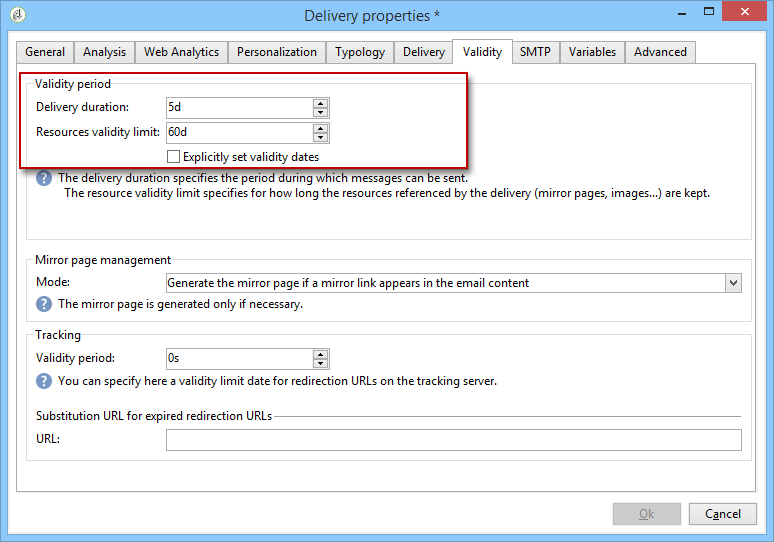

# Configurar e enviar a entrega {#configuring-and-sending-the-delivery}

Esta página descreve as configurações de envio de delivery específicas para instalações locais e híbridas do Campaign Classic v7.

Como parte da transição do Campaign v7 para o v8, o conjunto de documentações do Campaign Classic foi simplificado e reorganizado. Os recursos comuns agora estão disponíveis apenas no conjunto de documentações do Campaign v8. Para saber mais sobre as configurações de envio de entrega, consulte a [documentação do Campaign v8](https://experienceleague.adobe.com/pt-br/docs/campaign/campaign-v8/send/validate/configure-and-send){target=_blank}.

{target=_blank}

## Parâmetros adicionais de entrega {#delivery-additiona-parameters}

Antes de enviar a entrega, você poderá definir os parâmetros de envio nas propriedades da entrega, por meio da guia **[!UICONTROL Delivery]**.

* **[!UICONTROL Test SMTP delivery]**: use essa opção para testar o envio via SMTP. A entrega é processada até a conexão com o servidor SMTP, mas não é enviada: para cada destinatário do delivery, o Campaign se conecta ao servidor do provedor SMTP, executa o comando SMTP RCPT TO e encerra a conexão antes do comando SMTP DATA.

  >[!NOTE]
  >
  >* Essa opção não deve ser definida no mid-sourcing.
  >
  >* Saiba mais sobre a configuração do servidor SMTP [nesta seção](../../installation/using/configure-delivery-settings.md).

## Configurar novas tentativas {#configuring-retries}

>[!IMPORTANT]
>
>Para instalações hospedadas ou híbridas, se você tiver atualizado para o [MTA aprimorado](sending-with-enhanced-mta.md), as configurações de nova tentativa na entrega não serão mais usadas pelo Campaign. As tentativas de rejeição temporária e o intervalo de tempo entre elas são determinados pelo MTA aprimorado com base no tipo e na gravidade das respostas de rejeição que retornam do domínio de email da mensagem.

Para instalações no local e instalações hospedadas/híbridas usando o MTA herdado do Campaign, a seção central da guia **[!UICONTROL Delivery]** para parâmetros de entrega indica quantas tentativas devem ser executadas no dia seguinte à entrega e o atraso mínimo entre as tentativas.

Por padrão, cinco tentativas são agendadas para o primeiro dia da entrega, com um intervalo mínimo de uma hora distribuído pelas 24 horas do dia. Uma nova tentativa por dia é programada depois disso e até o prazo da entrega, que é definido na guia **[!UICONTROL Validity]**. Consulte [Definir o período de validade](#defining-validity-period).

## Definir o período de validade {#defining-validity-period}

Quando a entrega for iniciada, as mensagens (e todas as tentativas) poderão ser enviadas até o prazo da entrega. Isso é indicado nas propriedades de entrega, por meio da guia **[!UICONTROL Validity]**.

* O campo **[!UICONTROL Delivery duration]** permite inserir o limite de novas tentativas de entrega globais. Isso significa que o Adobe Campaign envia as mensagens começando na data inicial e, em seguida, para mensagens que retornam somente um erro, tentativas regulares e configuráveis são executadas até que o limite de validade seja atingido.

  >[!IMPORTANT]
  >
  >Para instalações hospedadas ou híbridas, se você tiver atualizado para o [MTA aprimorado](sending-with-enhanced-mta.md), a configuração **[!UICONTROL Delivery duration]** nas entregas de email do Campaign será usada somente se definida como **3,5 dias ou menos.**. Se você definir um valor superior a 3,5 dias, ele não será levado em consideração.

* **Limite da validade de recursos**: o campo **[!UICONTROL Validity limit]** é usado para recursos carregados, principalmente para a mirror page e imagens. Os recursos desta página são válidos por tempo limitado (para economizar espaço em disco).

  Os valores neste campo podem ser expressos nas seguintes unidades: **s** para segundos, **m** para minutos, **h** para horas, **d** para dias (padrão) e **a** para anos.
