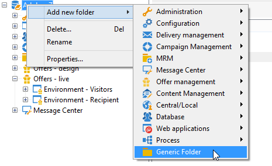
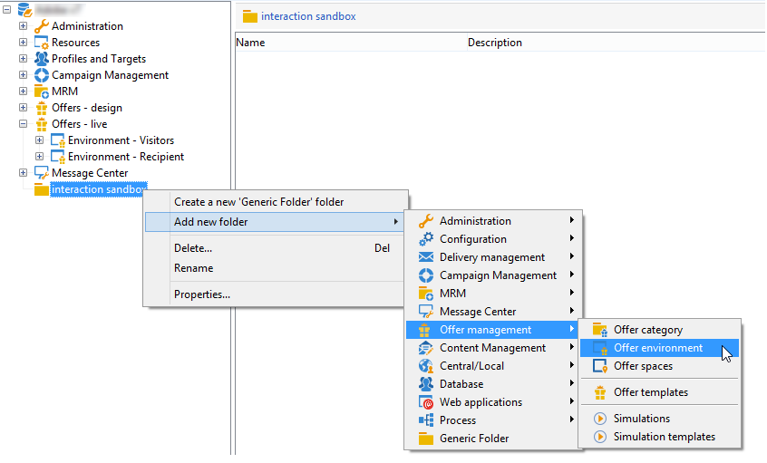
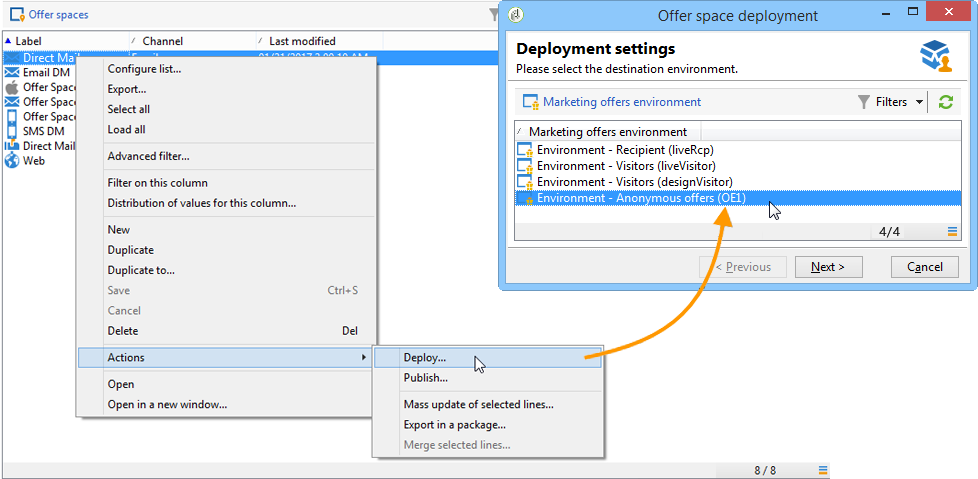

# Criação de um ambiente de teste{#creating-a-test-environment}

Para criar um ambiente de teste (modo sandbox), siga as etapas abaixo:

>[!IMPORTANT]
>
>Use somente esse método de criação de ambiente para ambientes de teste. Em todos os outros casos, use o assistente de target mapping. Para obter mais informações sobre isso, consulte [Criar um ambiente de ofertas](https://experienceleague.adobe.com/pt-br/docs/campaign/campaign-v8/offers/interaction-settings/interaction-env#create-an-offer-environment){target="_blank"} (documentação do Campaign v8).

1. Inicie o explorer do Adobe Campaign e vá para a raiz da instância.
1. Clique com o botão direito do mouse e adicione um **[!UICONTROL Generic folder]** usando os menus suspensos.

   

1. Em seguida, acesse a pasta que acabou de criar e adicione um **[!UICONTROL Offer environment]** usando os menus do botão direito do mouse.

   

1. Aplique o mesmo processo para criar as subpastas e os elementos do ambiente.
1. Depois que os testes forem concluídos e quiser usar o ambiente em produção, duplique as ofertas e espaços no ambiente de design. (Clique com o botão direito do mouse em > **[!UICONTROL Actions]** > **[!UICONTROL Deploy]** ).

   
